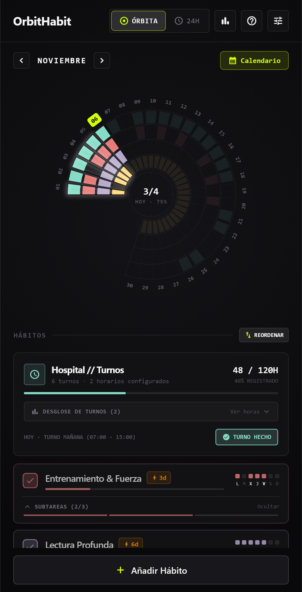
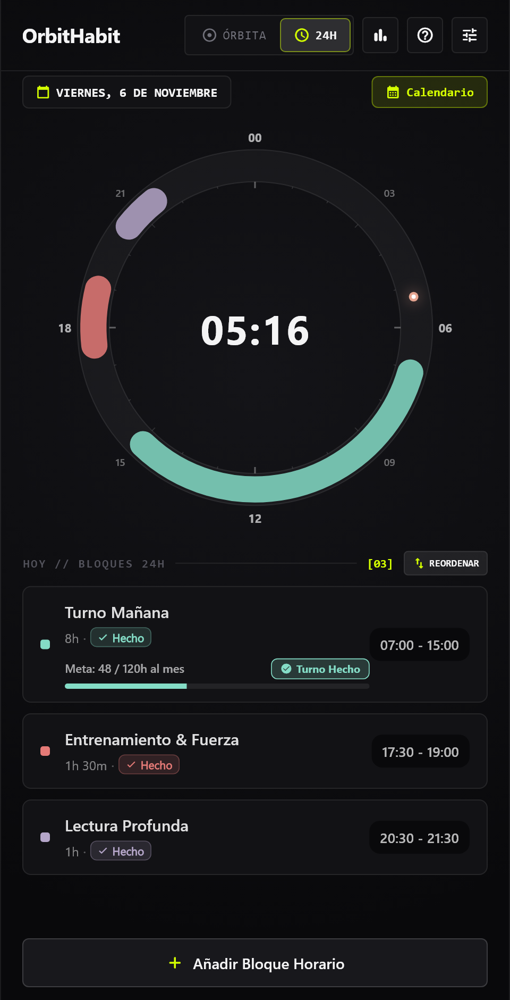
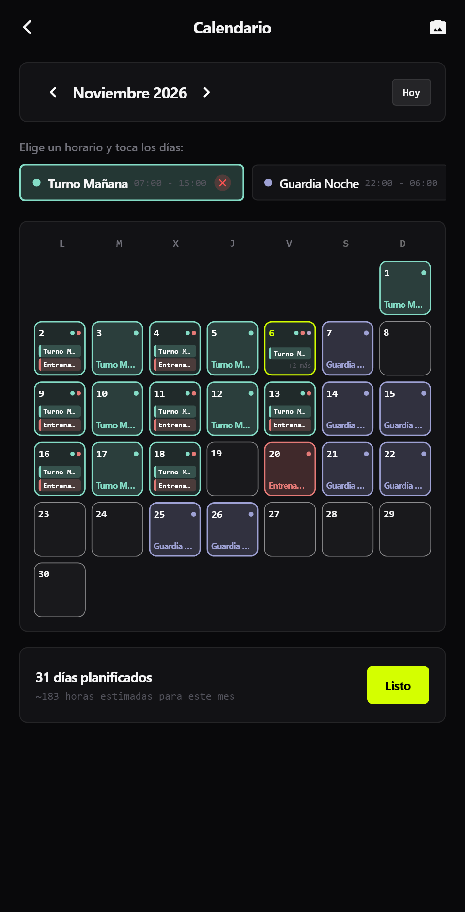
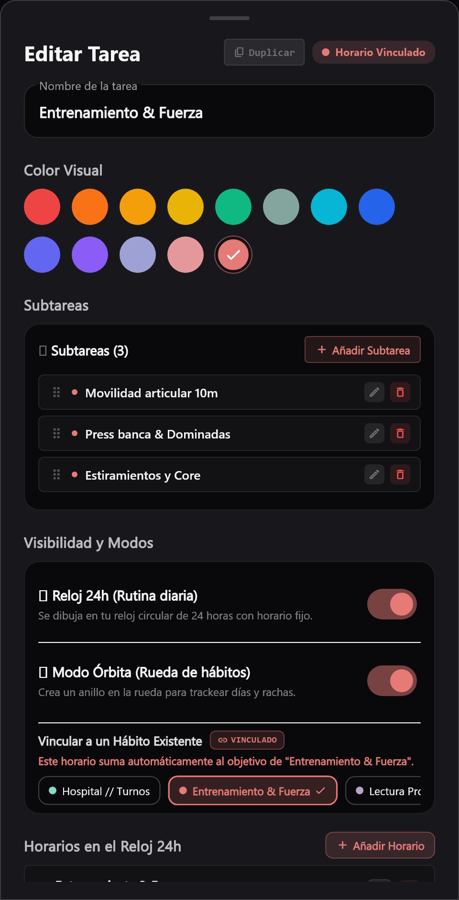
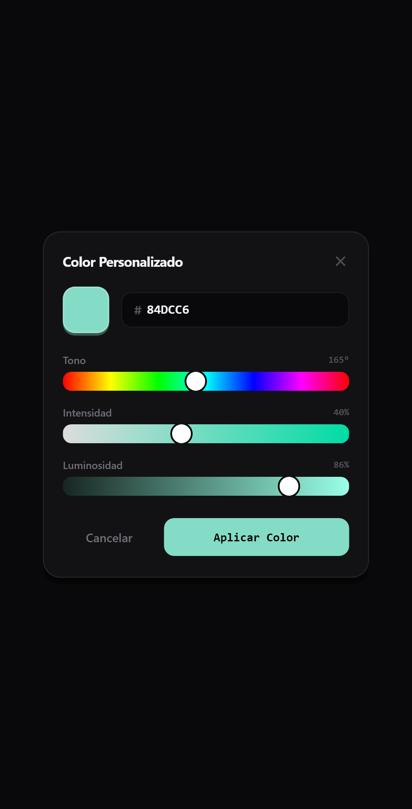
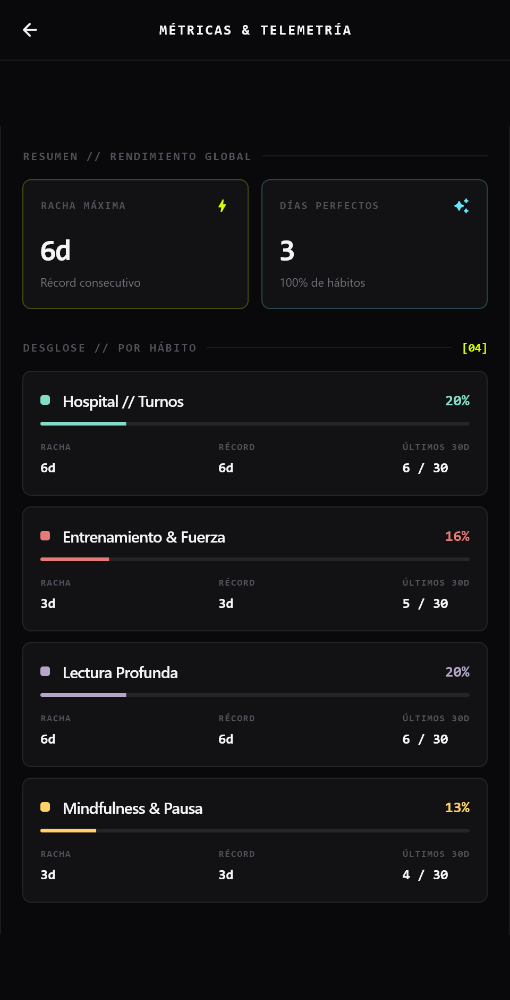
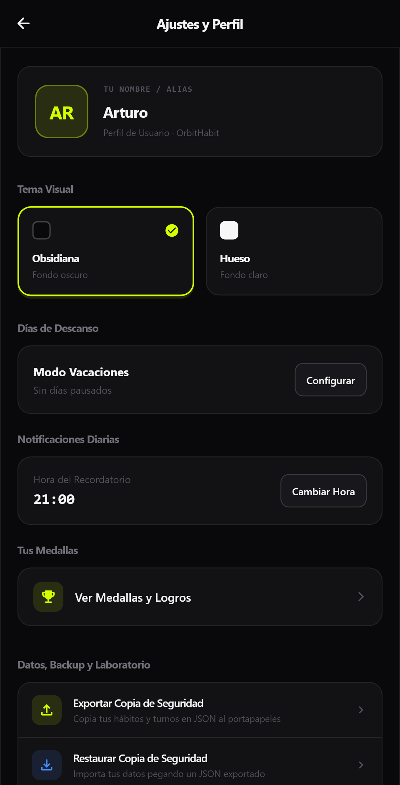
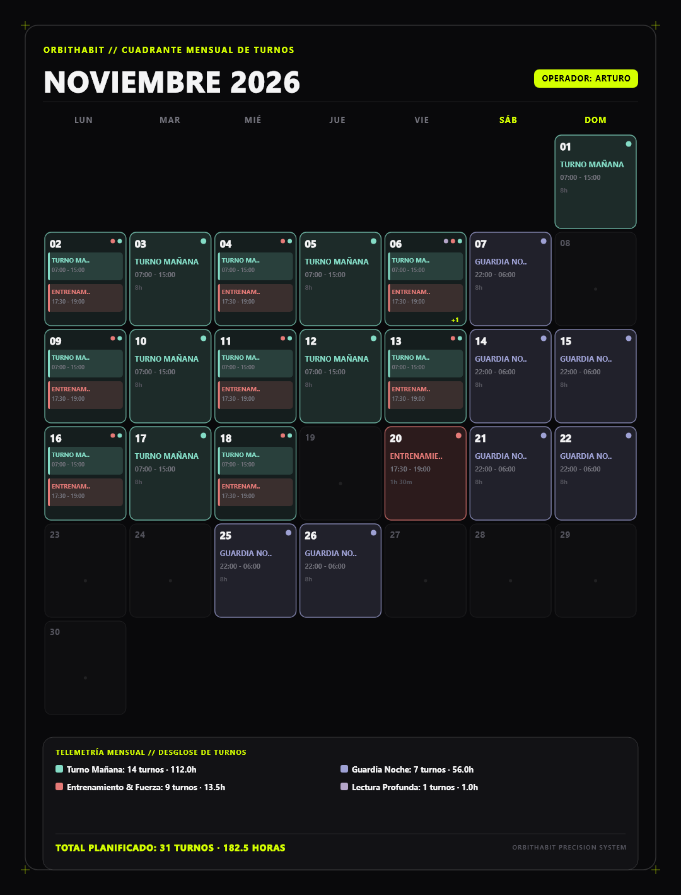

<p align="center">
  
</p>

<h1 align="center">🪐 OrbitHabit</h1>

<p align="center">
  <strong>Swiss-Engineered Orbital Habit Tracker, 24H Polar Clock & Shift Quadrant Planner</strong>
  <br/>
  <em>Built with Flutter · 120Hz Custom Canvas · 100% Offline · Zero Ads · Zero Tracking</em>
</p>

<p align="center">
  
  
  
  
  
  
</p>

<p align="center">
  <a href="https://github.com/arturo-orient/OrbitHabit/releases/latest/download/OrbitHabit.apk">
    
  </a>
</p>

---

## 📸 Interface Gallery (v1.2.6)

### 1. Core Orbital Views & Multi-Task Shift Calendar
<p align="center">
  
  &nbsp;&nbsp;
  
  &nbsp;&nbsp;
  
</p>
<p align="center">
  <em><strong>01. Rueda Orbital Mensual</strong> (con Objetivo Mensual y Checklist de Subtareas) &nbsp;·&nbsp; <strong>02. Reloj Polar 24H en Vivo</strong> &nbsp;·&nbsp; <strong>03. Calendario Multi-Turno</strong> (Drag-to-Paint)</em>
</p>

### 2. Task Engineering, Full-Spectrum Color, Telemetry & Swiss Settings
<p align="center">
  
  &nbsp;&nbsp;
  
  &nbsp;&nbsp;
  
  &nbsp;&nbsp;
  
</p>
<p align="center">
  <em><strong>04. Creador Unificado</strong> (Subtareas + Duplicar) &nbsp;·&nbsp; <strong>05. Selector Cromático HSV/HEX</strong> &nbsp;·&nbsp; <strong>06. Métricas & Telemetría</strong> &nbsp;·&nbsp; <strong>07. Ajustes, Modos y Backup</strong></em>
</p>

### 3. High-Resolution 1080p Monthly Quadrant Poster Export
<p align="center">
  
</p>
<p align="center">
  <em><strong>08. Póster Mensual 1080×1440 PNG</strong> generado nativamente con desglose de turnos, indicadores multi-tarea y telemetría de horas</em>
</p>

---

## 🚀 What's New in v1.2.6

OrbitHabit **v1.2.6** delivers a major visual and ergonomic leap combining the new **"Warm Lo-Fi Orbital"** brand identity, Swiss Grid UI refinements, a complete interactive Subtasks Checklist ecosystem, and a Multi-Task Shift Calendar:

* 🪐 **New "Warm Lo-Fi Orbital" Mathematical Vector Icon (`assets/icon/app_icon.png`)**:
  * Programmatically rendered at `1024×1024` via `dart:ui` (`Canvas` & `PictureRecorder`) strictly respecting the Android Adaptive Icon Safe Zone (`r ≤ 310px`).
  * Features a warm-cool triad of concentric arcs (**Emerald Sage → Luminous Mint**, **Coral Rose → Warm Peach**, and **Golden Amber → Solar Sand**) over a deep obsidian radial glow (`#0D0E12`), with a luminous solar core and an orbiting satellite.
  * Includes transparent foreground assets for **Android 14/15 Adaptive Icon parallax** (`mipmap-anydpi-v26`) and **Android 12+ native Splash API** (`values-v31`).
* 🎛️ **Swiss Ergonomic Header & Unified `[ Calendario ]` Access (`HomeScreen`)**:
  * **Decluttered Top Bar**: Removed the redundant user name badge next to the brand mark to give maximum breathing room to the primary navigation controls.
  * **Expanded `[ ÓRBITA | 24H ]` Selector**: Enlarged touch targets (`padding: 12×7`, `15px` icons, `11.5px` high-contrast typography, and active border) paired with a smooth **dimensional cubic morph transition** (`AnimatedSwitcher` with micro-scale `0.965 → 1.0`).
  * **1-Tap `[ Calendario ]` Pill in Both Views**: Accessible directly from both the Monthly Orbit view (`< MES >` bar) and the 24H Clock view with a unified accent pill button.
* 💼 **Cleaner Monthly Work Target Card (`MonthlyWorkTargetCard`)**:
  * Relocated the quick overtime adjustment controls (`EXTRA: [-1h] [+1h] [+2h]`) inside the expandable **`[ ⏷ DESGLOSE DE TURNOS ]`** accordion right below the shift breakdown list.
  * Freed the primary card footer for a clean, distraction-free layout with generous vertical spacing.
* 📝 **Full Subtasks Checklist Ecosystem (`SubTask` & `HabitProgressCard`)**:
  * **Interactive Inline Checklist**: Expandable checklist within each habit card with live `SUBTAREAS (X/Y)` counters. Completing all subtasks automatically checks off the parent habit with celebratory feedback.
  * **Micro-Segmented Progress Bar**: High-precision segmented visual meter that lights up segment-by-segment in the habit's exact color as subtasks are completed.
  * **Drag & Drop + In-Situ Editing**: Reorder subtasks via technical drag handles, or edit/delete individual subtasks in `UnifiedTaskSheet` without altering parent habit history.
* 📅 **Multi-Task Calendar & Continuous Drag-to-Paint (`ShiftCalendarScreen`)**:
  * **Multi-Task Day Cell Architecture**: Assign 2 or more shifts/routines to the same calendar day without overwriting. Rendered with geometric chromatic dots, dual schedule pills, and automatic `+N más` overflow indicators.
  * **Continuous Drag-to-Paint**: Glide your finger across calendar cells to paint or erase shifts across multiple days with tactile haptic feedback.
  * **Day Inspector on Long Press**: Long-press any day to inspect all assigned shifts, adjust daily overtime (`-1h`, `+1h`, `+2h`), or jump straight to editing a shift block.
* ⎘ **1-Touch Task Duplication & In-Place Reorder Sheets**:
  * **`[ ⎘ Duplicar ]` in `UnifiedTaskSheet`**: Clone complex routines, subtasks, colors, and schedules with confirmation and fresh IDs.
  * **`[ ⇅ REORDENAR ]` Modals**: Reorder habits (`HÁBITOS`) or daily schedule blocks (`HOY // BLOQUES 24H`) in real time via dedicated Swiss Bento modal sheets.
* 🛡️ **Heavy Duty Streak Shield (`StreakUtils.computeHeavyDutyShieldDates`)**:
  * Days with demanding marathon work shifts ($\ge 12\text{h}$ total, e.g., hospital or emergency guards) automatically shield secondary habit streaks from breaking.
* 🖼️ **Refined 1080p Monthly Poster Layout (`SchedulePosterService`)**:
  * Selective block filtering (`includedBlockIds`), toggleable telemetry footer, balanced header spacing, and a 2-column shift breakdown grid that prevents long shift names from colliding.

---

<details>
<summary>📜 <strong>Previous Changelog: v1.2.0 – v1.2.5 Highlights</strong></summary>

#### 🚀 What's New in v1.2.5 (Smart Overnight 24H Clock Dial & Zero-False-Hours Precision)
* 🌙 **Smart Overnight 24H Clock Dial Splitting (`OrbitClock24`)**:
  * Night shifts crossing midnight (e.g. `23:00 → 07:00`) decompose into strict daily arcs on the 24-hour circular dial:
    * **Shift start day (Today)**: Only the evening segment (`23:00 → 24:00`) is drawn. The morning (`00:00 → 07:00`) remains blank unless yesterday was also a night shift.
    * **Shift completion day (Tomorrow)**: The morning completion arc (`00:00 → 07:00`) is rendered as carrying over from last night.
* ⏱️ **Zero-False-Hours Guarantee**:
  * Unified `ScheduleBlock` and `WorkShiftGroup` calculation so shifts scheduled for today are strictly ignored until actually completed by the user.

#### 🚀 What's New in v1.2.4 (Strict In-Progress Day Math & App Label Polish)
* ⏱️ **Strict In-Progress Work Hours (`today` is not pre-counted)**:
  * Shifts scheduled for today (`d == todayIso`) are no longer automatically added to monthly worked hours until completed by the user.
* 🏷️ **Native App Name & APK File Branding**:
  * Formatted native Android launcher label to **`OrbitHabit`**.

#### 🚀 What's New in v1.2.3 (Native Android MediaStore & System Share Sheet)
* 🖼️ **Native MediaStore Image Pipeline (`MediaStore.Images.Media`)**:
  * Postcards are inserted directly into Android's public `Pictures/OrbitHabit/` album, immediately indexed in Google Photos and Gallery apps without broad storage permissions.
* 📤 **Native System Share Sheet (`FileProvider`)**:
  * Send posters directly to WhatsApp, Telegram, Google Drive, or system destinations via secure `content://` URIs.

#### 🚀 What's New in v1.2.2 (Real Poster Download, Demo Life-Cycle Banner & 5-Step Guided Tour)
* 💾 **Real Multiplatform Poster PNG Download (`PosterSaver`)**:
  * Zero-dependency conditional imports (`stub` / `io` / `web`) for saving posters across Android, Web, and Desktop.
* 🛡️ **Active Demo Mode Banner & 1-Click Exit with Auto-Backup (`DemoSeederService`)**:
  * Automatically backs up user data (`pre_demo_backup_json`) before loading the demo orbit and restores it in 1 click (`[ ✕ Salir de la Demo ]`).
* 🧭 **Interactive 5-Step Guided Tour (`HomeScreen._buildTourOverlay`)**:
  * Tapping `[ ? ]` in the top bar launches an interactive 5-step walkthrough over the live interface.

#### 🚀 What's New in v1.2.1 (1080p Schedule Poster, Polar Clock Touch, Interactive Guide & 120Hz Canvas)
* 🖼️ **1080p High-Resolution Schedule Poster Export (`SchedulePosterService`)**:
  * Direct rendering to a `1080×1440` PNG poster of your monthly shift quadrant.
* ⏰ **Interactive Polar Touch in 24-Hour Orbit Clock (`OrbitClock24`)**:
  * Tap directly on any circular time block arc in the 24-hour dial to inspect or edit the block.
* ⚡ **120Hz Direct GPU Canvas Optimization (`OrbitPainter.paint`)**:
  * Replaced per-cell `Path` allocation with direct hardware-accelerated `canvas.drawArc` stroked geometry.

#### 🚀 What's New in v1.2.0 (Zero-Permission Backup & Instant Demo Release)
* ⚡ **Blueprint Empty State & 1-Click Demo Orbit (`DemoSeederService`)**.
* 📦 **Zero-Permission JSON Backup & Restore (`BackupService`)**.
* 🛡️ **DST-Immune Streak Math & 120Hz `RepaintBoundary` Isolation**.

</details>

<details>
<summary>📜 <strong>Previous Changelog: v1.1 – v1.1.3 Highlights</strong></summary>

* **v1.1.3**: Accessibility & Text Scaling Lock (`TextScaler.noScaling`) and custom HEX color persistence fixes.
* **v1.1.2**: Unified Work Shifts Architecture (`WorkShiftGroup`) consolidating rotating shifts under a single orbital ring with collapsible breakdown (`[ ⏷ DESGLOSE DE TURNOS ]`).
* **v1.1.1**: Interactive Shift & Schedule Planner (`ShiftCalendarScreen`), Multi-Schedule Task Creator (`UnifiedTaskSheet`), and Full-Spectrum HSV/HEX Color Picker (`CustomColorPickerDialog`).
* **v1.1.0**: 24-Hour Orbit Clock (`OrbitClock24`), Overnight Shift support, Monthly Work Hours Target (`120h`), and Secret Achievement #27 ("🔥 Dedicado").

</details>

---

## ✨ Core Features

Most habit trackers rely on monotonous checkboxes or rigid spreadsheets. **OrbitHabit visualizes your month as a horseshoe-shaped orbital ring and your day as a 24-hour astronomical clock** — engineered for both daily habits and complex rotating work shifts.

- 🪐 **Monthly Orbital Wheel (`OrbitTracker`)** — Hand-painted with Flutter's `CustomPaint` API at 120Hz. Days `1..31` are radial segments, habits are concentric rings, and unscheduled rest days display clean negative space.
- ⏰ **24-Hour Polar Clock (`OrbitClock24`)** — Live orbiting satellite indicator, color-coded time blocks, smart midnight splitting for overnight shifts, and 1-tap polar touch editing.
- 🗓️ **Multi-Task Shift Calendar (`ShiftCalendarScreen`)** — Plan rotating shifts (*Mañana*, *Tarde*, *Guardia Noche*) and routines with continuous drag-to-paint, multi-task cells, and real-time monthly hour projections.
- 📝 **Interactive Subtasks & Micro-Meters (`HabitProgressCard`)** — Break complex habits into actionable checklists with segmented visual progress bars.
- 🖼️ **1080p Quadrant Poster Generator (`SchedulePosterService`)** — Export your monthly schedule and shift telemetry as a high-contrast Swiss poster ready to share or print.
- 🏆 **27 Vector Achievements & Heavy Duty Shield** — Hand-drawn geometric trophies (`CustomPainter`), PlayStation-style unlock popups, Zen confetti physics, and automatic streak protection on $\ge 12\text{h}$ marathon shift days.
- 🌓 **Dual High-Craft Themes** — **Obsidiana** (`#0A0A0A` pure dark grid) and **Hueso Editorial** (`#F6F5F2` warm bone paper), with automatic night dimming.
- 🔒 **100% Offline & Private** — Local Hive persistence with zero-permission JSON backup/restore via clipboard. No accounts, no cloud tracking, no ads.

---

## 🏗️ Architecture

```text
lib/
├── main.dart                                 # App entry point, Hive bootstrap & TextScaler lock
├── data/
│   └── database_service.dart                 # Local Hive persistence layer (habits, schedule, settings)
├── domain/models/
│   ├── habit.dart                            # Core Habit & SubTask models + Hive TypeAdapters
│   ├── schedule_block.dart                   # ScheduleBlock model (multi-date & overnight shift support)
│   ├── work_shift_group.dart                 # Consolidated 1:N rotating work shift aggregator
│   ├── user_settings.dart                    # User preferences, themes & vacation dates
│   └── achievement.dart                      # 27 dynamically computed vector achievements
├── providers/
│   ├── habit_provider.dart                   # Riverpod Notifier — habit/subtask CRUD & sync
│   ├── schedule_provider.dart                # Riverpod Notifier — daily blocks & calendar assignments
│   └── settings_provider.dart                # Riverpod Notifier — settings, themes & trophy triggers
├── services/
│   ├── backup_service.dart                   # Zero-permission JSON export/import
│   ├── demo_seeder_service.dart              # 1-click realistic demo orbit with auto-backup/restore
│   ├── schedule_poster_service.dart          # 1080×1440 PNG monthly quadrant poster renderer
│   ├── notification_service.dart             # Local scheduled reminders (flutter_local_notifications)
│   ├── sound_service.dart                    # Precached audio feedback (audioplayers)
│   └── widget_service.dart                   # Native Android Home Widget sync (home_widget)
├── ui/
│   ├── theme/
│   │   └── app_theme.dart                    # Swiss Grid tokens, Obsidiana/Hueso palettes & typography
│   ├── screens/
│   │   ├── home_screen.dart                  # Dual view (Orbit / 24H), guided tour & reorder modals
│   │   ├── shift_calendar_screen.dart        # Multi-task calendar, drag-to-paint & poster preview
│   │   ├── statistics_screen.dart            # Telemetry, consistency heatmaps & streak metrics
│   │   ├── settings_screen.dart              # Theme switch, vacation shield, achievements & JSON backup
│   │   ├── manage_habits_screen.dart         # Habit archive & management
│   │   └── onboarding_screen.dart            # Swiss onboarding flow
│   └── widgets/
│       ├── orbit_tracker.dart                # ⭐ 120Hz horseshoe orbital chart with polar touch detection
│       ├── orbit_clock_24.dart               # ⏰ 24h polar clock dial with smart overnight splitting
│       ├── habit_progress_card.dart          # 📝 Habit card with inline SubTask checklist & micro-meter
│       ├── monthly_work_target_card.dart     # 💼 Work target card with collapsible shift breakdown & extra hours
│       ├── unified_task_sheet.dart           # 🎛️ Unified task/shift creator, subtask editor & duplicator
│       ├── custom_color_picker_dialog.dart   # 🎨 Full-spectrum HSV/HEX chromatic dialog
│       ├── orbit_guide_sheet.dart            # 📖 Interactive Swiss manual
│       ├── achievement_art_painter.dart      # 🏆 CustomPainter vector art for all 27 trophies
│       ├── confetti_overlay.dart             # 🎉 65-particle custom physics overlay
│       └── trophy_overlay.dart               # 🔔 PlayStation-style achievement unlock banner
└── utils/
    ├── date_utils.dart                       # Astronomical calendar helpers
    ├── poster_saver.dart                     # Multiplatform PNG saver (Android MediaStore, Web, Desktop)
    └── streak_utils.dart                     # DST-immune streak math & Heavy Duty ≥12h shift shield
```

---

## 🛠️ Tech Stack & Typography

| Layer | Technology |
|---|---|
| **Framework** | Flutter (Dart SDK `^3.12.0`) |
| **State Management** | `flutter_riverpod` 3.x (`Notifier<T>` with `ProviderScope` DI) |
| **Local Database** | `hive` + `hive_flutter` (custom binary `TypeAdapter`s) |
| **Display Typography** | `Plus Jakarta Sans` (Geometric Swiss Headlines) |
| **Body Typography** | `Inter` (High-legibility UI & checklists) |
| **Technical Monospace** | `JetBrains Mono` (`tabular-nums` telemetry, hours & badges) |
| **Canvas & Graphics** | Native `dart:ui` (`CustomPainter`, `PictureRecorder`, 0 chart packages) |
| **Platform Channels** | Android `MediaStore`, `FileProvider`, `AppWidgetProvider` & Local Notifications |

---

## 🎨 Chromatic System ("Warm Lo-Fi Orbital" & Swiss Grid)

| Swatch | Hex | Role / Name |
|---|---|---|
| ⬛ | `#0D0E12` | **Obsidiana Profundo** (Primary Dark Surface & Adaptive Icon Base) |
| ⬜ | `#F6F5F2` | **Hueso Editorial** (Primary Light Surface) |
| 🟢 | `#C8FF00` | **Lima Industrial** (High-Contrast Swiss Technical Accent) |
| 🧪 | `#52968C` → `#84DCC6` | **Salvia Esmeralda a Turquesa Menta** (Outer Orbital Ring) |
| 🪸 | `#E57A77` → `#FFAD87` | **Rosa Coral a Melocotón Luminoso** (Middle Orbital Ring) |
| ☀️ | `#E8993E` → `#FFD166` | **Ámbar Dorado a Arena Solar** (Inner Orbital Ring) |
| 🟣 | `#9EA1D4` / `#B5A6C9` | **Lavanda Nocturno** (Night Shifts & Deep Focus Blocks) |

---

## 📲 Installation & Development

### Direct Android APK
Download the latest signed APK from the [Releases](https://github.com/arturo-orient/OrbitHabit/releases) page or directly via [`OrbitHabit.apk`](OrbitHabit.apk):

> **Compatibility:** Android 5.0+ (API 21–35) · Adaptive Icons & Android 12+ Splash Screen supported · 100% Offline

### Build from Source

```bash
# 1. Clone the repository
git clone https://github.com/arturo-orient/OrbitHabit.git
cd OrbitHabit

# 2. Fetch dependencies
flutter pub get

# 3. Run static analysis & unit/widget test suite
flutter analyze
flutter test

# 4. Build release APK
flutter build apk --release
```

---

## 📄 License

This project is licensed under the MIT License — see the [LICENSE](LICENSE) file for details.

---

<p align="center">
  Designed & Engineered with Swiss Precision and Flutter by <a href="https://github.com/arturo-orient">Arturo Orient</a>
</p>
