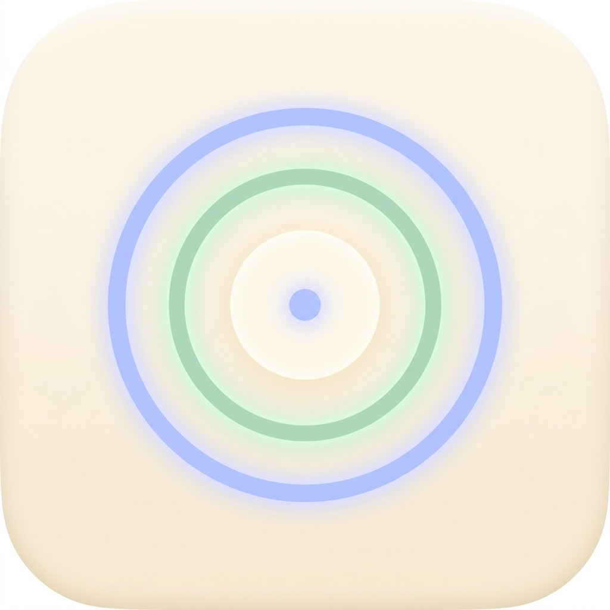
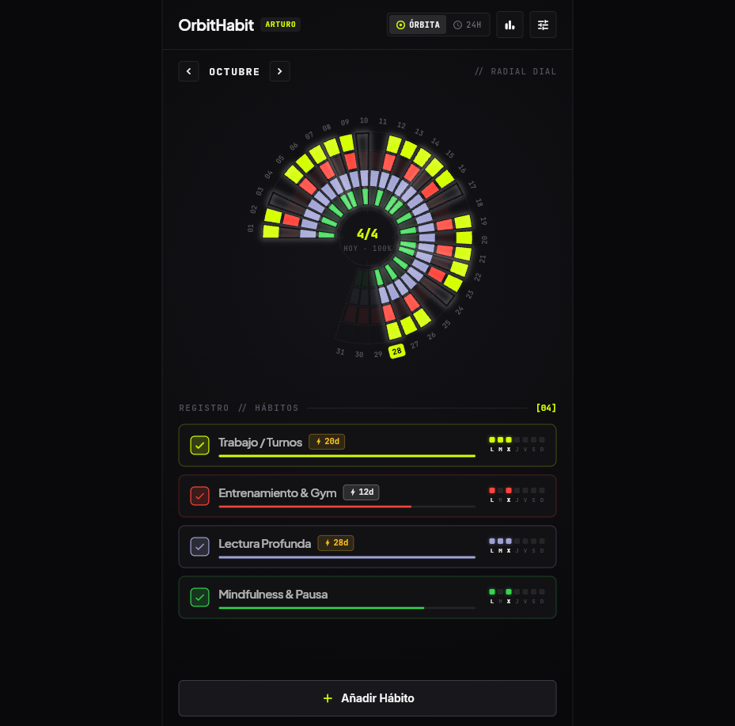
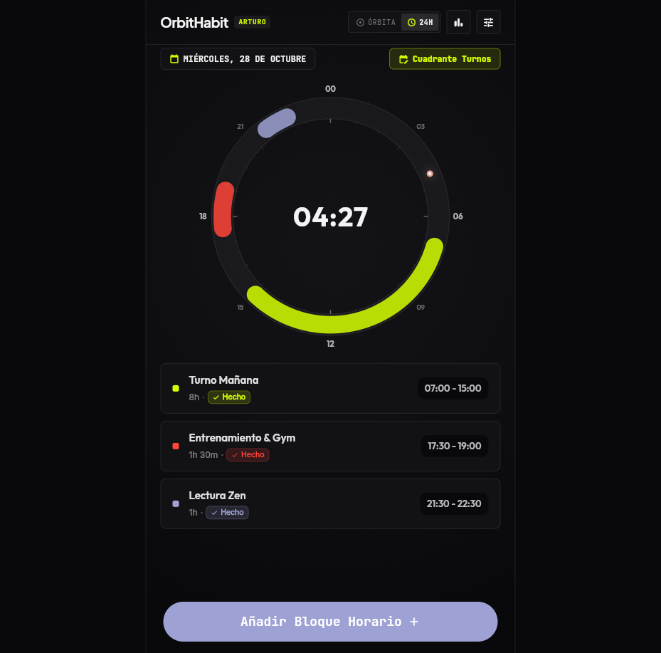
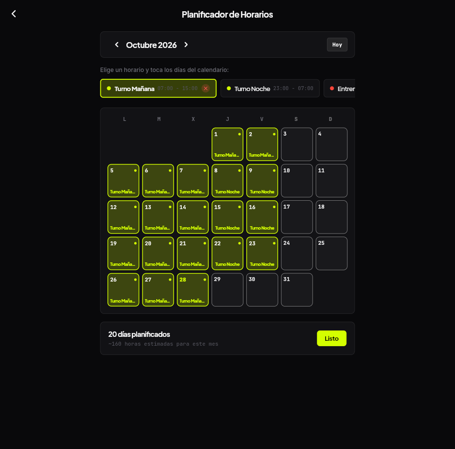
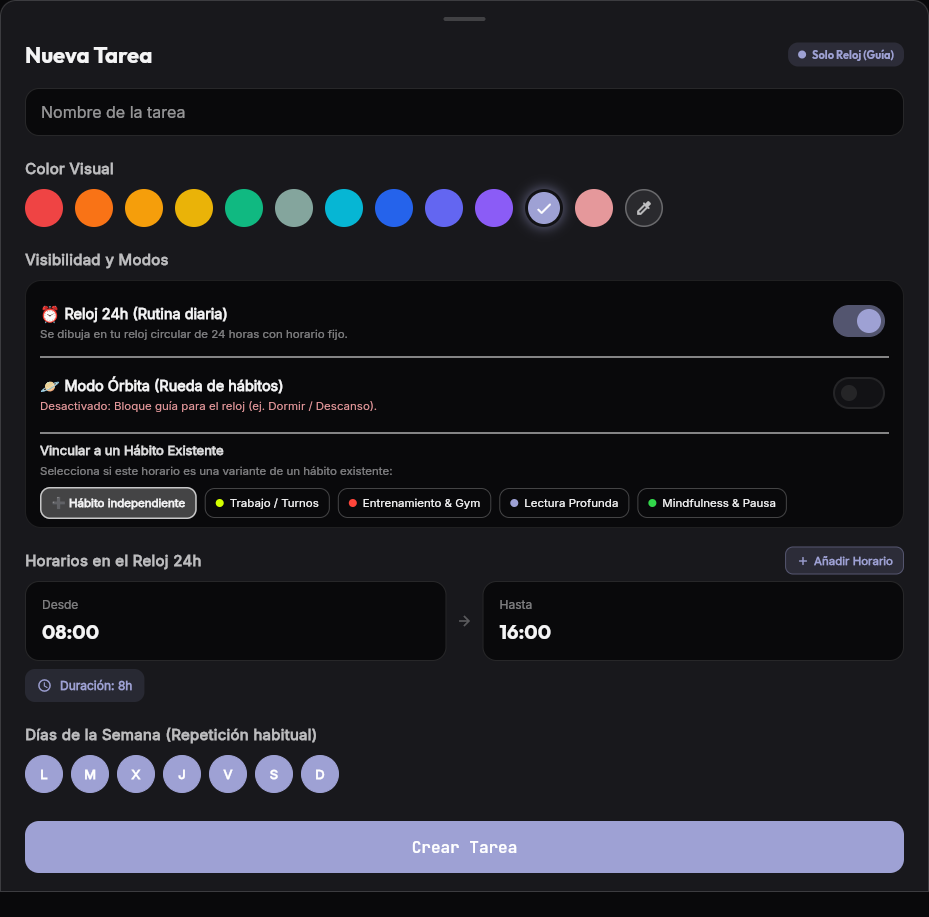
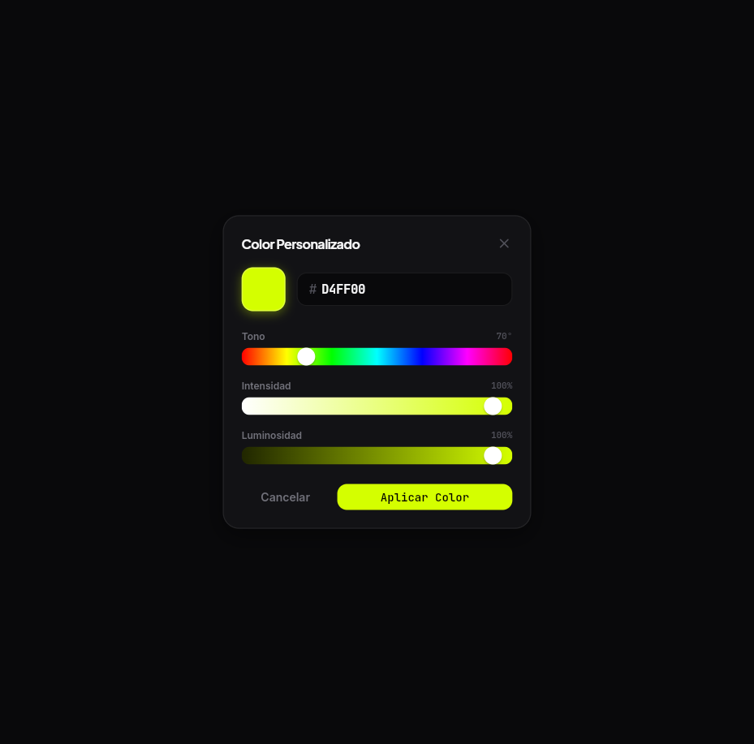
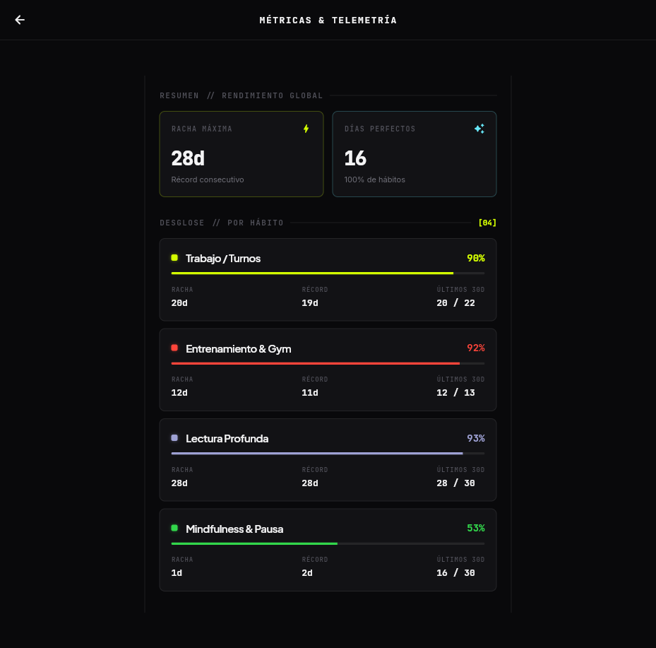
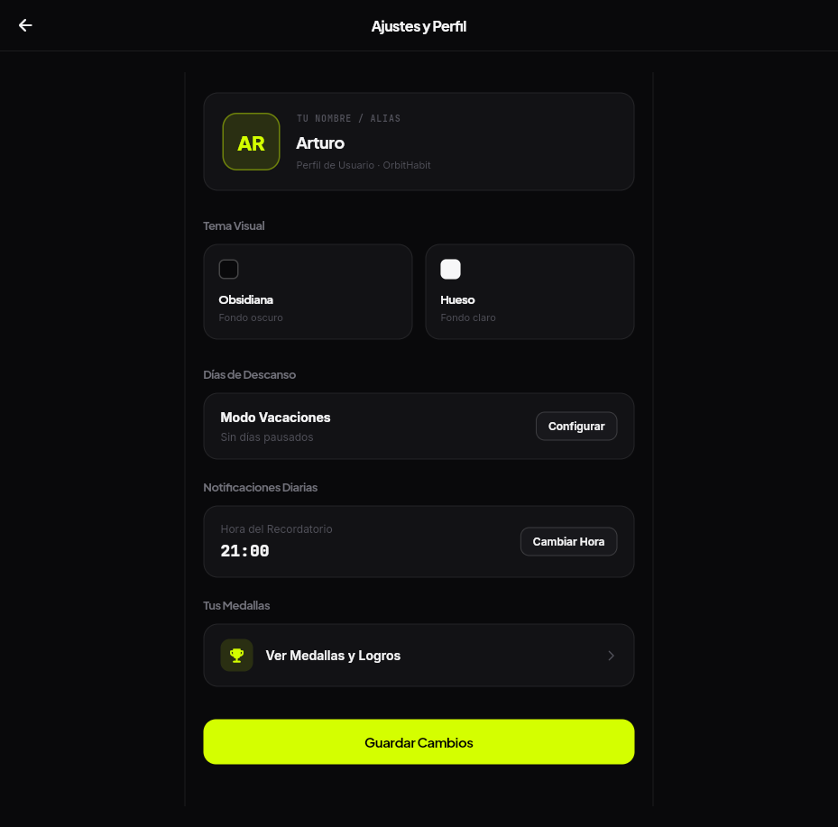

<p align="center">
  
</p>

<h1 align="center">🪐 OrbitHabit</h1>

<p align="center">
  <strong>A Zen habit tracker with a unique orbital visualization</strong>
  <br/>
  <em>Built with Flutter · 100% Offline · No Ads · No Tracking</em>
</p>

<p align="center">
  
  
  
  
  
</p>

---

<p align="center">
  
  &nbsp;&nbsp;
  
  &nbsp;&nbsp;
  
</p>
<p align="center">
  <em>01. Rueda Orbital Mensual &nbsp;·&nbsp; 02. Reloj Horario 24H en Vivo &nbsp;·&nbsp; 03. Planificador de Horarios & Turnos</em>
</p>

<p align="center">
  
  &nbsp;&nbsp;
  
  &nbsp;&nbsp;
  
  &nbsp;&nbsp;
  
</p>
<p align="center">
  <em>04. Creador Unificado &nbsp;·&nbsp; 05. Selector Cromático HSV/HEX &nbsp;·&nbsp; 06. Telemetría y Rachas &nbsp;·&nbsp; 07. Ajustes Zen</em>
</p>

#### 🚀 What's New in v1.2.0 (Engineering, Zero-Permission Backup & Instant Demo Release)
OrbitHabit v1.2.0 focuses on reactive state edge-case hardening, 120Hz canvas isolation, astronomical date math, and instant onboarding:

* ⚡ **Blueprint Empty State & 1-Click Demo Orbit (`DemoSeederService`)**:
  * When no habits are configured, `OrbitPainter` now renders a precision Swiss technical blueprint dial instead of a blank canvas.
  * Added **`[ ⚡ CARGAR ÓRBITA DEMO ]`** to instantly populate a realistic month of rotating shifts (*Mañana*, *Tarde*, *Noche*), overtime hours, and habits in 1 click.
* 📦 **Zero-Permission JSON Backup & Restore (`BackupService`)**:
  * Full local database export and import (`habits`, `scheduleBlocks`, `vacationDates`) via versioned JSON and system clipboard—requiring zero invasive Android storage permissions.
* 🧠 **1:N Reactive State & Overnight Midnight Boundary Fixes**:
  * **Deterministic Shift Sync**: Fixed `syncDateWithHabit` so toggling a parent work habit from the main card resolves the specific assigned shift instead of multiplying hours across all linked shifts.
  * **Double-Shift Invariant**: Unchecking one shift on a double-shift day preserves the parent habit completion as long as another shift remains active on that date.
  * **Overnight Effective Date (`01:30 AM` Edge Case)**: Completing an overnight shift (`23:00 → 07:00`) after midnight in `OrbitClock24` now accurately attributes completion to the shift's start date.
* 🛡️ **DST-Immune Streak Math & 120Hz `RepaintBoundary` Isolation**:
  * Replaced duration-based date stepping with astronomical calendar constructors (`DateTime(y, m, d ± 1)`) and UTC ISO-week calculations in `StreakUtils` to prevent Daylight Saving Time (23h/25h days) from breaking long streaks.
  * Wrapped `OrbitTracker` and `OrbitClock24` in strategic `RepaintBoundary` layers and refined `shouldRepaint` delegates.

<details>
<summary>📜 <strong>Previous Changelog: v1.1.3 Highlights</strong></summary>

#### 🚀 What's New in v1.1.3

OrbitHabit v1.1.3 brings critical bug fixes for display accessibility and custom theme persistence:

- 🔠 **Accessibility & Text Scaling Lock (`TextScaler.noScaling`)**:
  - Fixed an issue where system-level large text or accessibility zoom settings would stretch and distort the interface. The entire app layout, circular dials, and typography now stay surgically crisp at a 1:1 scale regardless of device display settings.
- 🎨 **Custom Color Persistence Fix**:
  - Fixed a bug where selecting a custom color in the color picker dialog was not properly persisting to parent habits and their associated schedule slots upon saving.
  - Enhanced HEX input handling to support both 3-digit and 6-digit hex formats with guaranteed full opacity.

</details>

<details>
<summary>📜 <strong>Previous Changelog: v1.1.2 Highlights</strong></summary>

OrbitHabit v1.1.2 introduces unified work activity management, intelligent shift breakdowns, and fixes future schedule completions:

- 🎛️ **Unified Work Shifts Architecture (`WorkShiftGroup`)**:
  - Rotating shifts (e.g. *Mañana*, *Noche*, *Tarde*) are now consolidated under a single parent work task (*"Trabajar"* / *"Trabajo"*).
  - Occupies **a single concentric ring** in the Monthly Orbit Wheel, eliminating duplicate rings for the same job.
  - Interactive **collapsible breakdown tile** (`[ ⏷ DESGLOSE DE TURNOS ]`) showing exact hours and shifts worked per schedule slot.
- 🎯 **Mathematical Precision & Phantom Hours Elimination**:
  - Replaced duplicate hour multipliers with exact date-by-date calendar assignment calculations. Each day only accounts for the specific shift worked.
- 🗓️ **Planned vs. Completed Distinction for Future Months**:
  - Planning ahead in the shift calendar for upcoming months (e.g. next month) now displays days as **scheduled guide silhouettes (8% subtle ghost cell)** instead of prematurely marking them as completed.
  - Clear telemetry differentiation between *Horas Planificadas* and *Horas Reales Trabajadas*.

</details>

<details>
<summary>📜 <strong>Previous Changelog: v1.1.1 Highlights</strong></summary>

<p align="center">
  
  &nbsp;&nbsp;&nbsp;&nbsp;
  
  <br/>
  <em>🗓️ Cuadrante Mensual de Turnos &nbsp;&nbsp;·&nbsp;&nbsp; 🎛️ Arquitectura Multi-Horario Unificada (v1.1.1)</em>
</p>

OrbitHabit v1.1.1 introduces comprehensive schedule planning, multi-slot routine architecture, precision color customization, and refined Swiss negative-space design:

- 🗓️ **Interactive Shift & Schedule Planner (`ShiftCalendarScreen`)**:
  - Dedicated monthly cuadrante calendar to plan, assign, and visualize rotating work shifts, study schedules, or custom routines across any month.
  - Multi-shift palette with instant day painting (`1-tap to schedule`, `1-tap to erase`).
  - Real-time monthly hours tracker calculating projected workload and shifts count.
  - Direct shift deletion (`✕` badge & confirmation) with automatic cascading cleanup of orphan entries.
- 🎛️ **Multi-Schedule Architecture in Task Creator (`UnifiedTaskSheet`)**:
  - Define multiple schedule slots per activity directly from the task creator (*e.g., "Mañana: 07:00 - 15:00"* and *"Noche: 23:00 - 07:00"* under a single parent habit *"Trabajo"*).
  - Universal terminology (*"Añadir Horario"*, *"Nuevo Horario"*, *"Sesiones este mes"*) adapted for any discipline (work, study, workout, mindfulness, sleep).
  - Intelligent schedule conflict resolution: specific slots automatically supersede base placeholder hours to prevent visual clock collisions.
- 🎨 **Full-Spectrum Chromatic Color Picker (`CustomColorPickerDialog`)**:
  - Interactive HSV color spectrum with real-time hue bar, saturation-value canvas, and live preview.
  - Direct 6-character HEX code input with auto-validation for surgical branding precision.
  - Quick-access curated Zen author palettes alongside full custom RGB spectrum.
- 🧘 **True Zen Negative Space (Clean Off-Days)**:
  - **24-Hour Orbit Clock**: On rest days or unscheduled dates, the clock remains 100% clean and diaphanous—no ghost blocks cluttering your free time.
  - **Monthly Orbit Wheel**: Non-scheduled days (weekends, off-shift days) display pure negative space with only the fine orbital guide rail, highlighting the natural rhythm of work and rest without toothless or broken grid artifacts.
  - **Scheduled vs. Completed Distinction**: Scheduled pending days show a subtle 8% ghost cell; completed days light up in full author color.

</details>

<details>
<summary>📜 <strong>Previous Changelog: v1.1 Highlights</strong></summary>

- ⏰ **24-Hour Orbit Clock (`OrbitClock24`)**: A bespoke circular 24h dial inspired by astronomical dials. Features a live orbiting satellite indicator, color-coded time blocks, and effortless 1-tap habit completion.
- 🌙 **Overnight & Rotating Shifts Support**: Seamlessly cross midnight without breaking timeline calculations (e.g. night shifts like `23:00 → 07:00` are rendered smoothly across the day boundary).
- 💼 **Monthly Work Hours Target (120h)**:
  - Designed for shift workers and professionals needing monthly hour goals rather than daily streaks.
  - Interactive 1..31 calendar modal to log hours on any past or present day of the month with quick presets (4h, 6h, 7.5h, 8h, 10h, 12h) or custom values.
  - Live overtime calculation (+Xh) and instant progress rings with dynamic color shifts as you approach your goal.
- 🎛️ **Unified Zen Task Sheet (`UnifiedTaskSheet`)**: Progressive-disclosure creation sheet that consolidates Habit tracking and Schedule blocking into one clean workflow.
  - **Visibility Controls**: Decide whether a block lives in the **Orbit**, in the **Clock**, or in **both** (perfect for passive routines like "Dormir" that guide your day on the clock without cluttering the monthly ring).
  - Clean categorization, frequency selectors, and time-block pickers.
- 🔄 **Bidirectional Sync & Clean Views**: Habits linked to schedule blocks automatically update each other. Habits with monthly targets display a dedicated Zen target card and won't produce duplicate percentage cards.
- 🏆 **New Secret Achievement #27 ("🔥 Dedicado")**: Unlocked upon logging 120 or more hours of work in a single month, complete with PlayStation-style trophy popup and sound.

</details>

## ✨ Core Features

Most habit trackers use boring checkboxes or simple calendars. **OrbitHabit visualizes your month as a horseshoe-shaped orbital ring** — each habit is a concentric arc, and completed days light up in color. It's inspired by the Apple Watch activity rings, but reimagined as a celestial orbit.

**Key highlights:**
- 🎨 **Custom orbital visualization** — Entirely hand-painted with Flutter's `CustomPaint` API (no libraries). Days are arc segments, habits are rings, and "perfect days" glow.
- 🏆 **27 unique achievements** — Each with hand-drawn vector art (geometric illustrations painted with `CustomPainter`). Includes 15 hidden trophies and easter eggs.
- 🎮 **Gamification system** — Streak tiers (Bronze → Silver → Gold → Diamond) with animated glowing borders and haptic feedback.
- 🔔 **PlayStation-style trophy popups** — Slide-in notifications when you unlock an achievement, with custom sounds.
- 🎉 **Zen confetti physics** — 65 particles with custom fall speed, sway, and rotation. No libraries — pure math.
- 🌙 **5 visual themes** — Crema, Pizarra (dark), OLED (pure black), Bosque Salvia, and Auto. Night dimming after 10 PM.
- 📱 **Native Android home widget** — See today's progress without opening the app.
- 🔇 **100% offline** — All data stored locally with Hive. No accounts, no servers, no tracking.

## 🏗️ Architecture

```
lib/
├── main.dart                          # App entry point + theme definitions
├── data/
│   └── database_service.dart          # Hive persistence layer (2 boxes: habits & schedule)
├── domain/models/
│   ├── habit.dart                     # Core Habit model + Hive TypeAdapter + monthly hours
│   ├── schedule_block.dart            # Schedule block model (overnight shift support)
│   ├── user_settings.dart             # User preferences model
│   └── achievement.dart               # 27 dynamically computed achievements
├── providers/
│   ├── habit_provider.dart            # Riverpod Notifier — habit CRUD + monthly hour logs
│   ├── schedule_provider.dart         # Riverpod Notifier — daily schedule blocks
│   └── settings_provider.dart         # Riverpod Notifier — settings + confetti
├── services/
│   ├── backup_service.dart            # Zero-permission JSON export/import & demo data seeder
│   ├── notification_service.dart      # Daily reminders (flutter_local_notifications)
│   ├── sound_service.dart             # 3 precached audio effects (audioplayers)
│   └── widget_service.dart            # Android home widget sync (home_widget)
├── ui/
│   ├── screens/                       # 6 screens (Home, Shift Calendar, Onboarding, Settings, Stats, Manage)
│   └── widgets/
│       ├── orbit_tracker.dart         # ⭐ Signature widget — horseshoe orbital chart with clean rest gaps
│       ├── orbit_clock_24.dart        # ⏰ 24-hour circular dial with live satellite tracking
│       ├── unified_task_sheet.dart    # 🎛️ Unified habit & multi-schedule creator with visibility toggles
│       ├── custom_color_picker_dialog.dart # 🎨 Full-spectrum chromatic color picker with HEX support
│       ├── monthly_work_target_card.dart # 💼 120h work target card with interactive month logger
│       ├── schedule_block_card.dart   # Daily timeline cards
│       ├── achievement_art_painter.dart # Vector art for each trophy (CustomPainter)
│       ├── confetti_overlay.dart       # Custom particle physics system
│       ├── trophy_overlay.dart         # PlayStation-style achievement popup
│       └── ...                        # Zen UI components
└── utils/
    ├── date_utils.dart                # Date helpers
    └── streak_utils.dart              # Streak calculation (supports 2 frequency types)
```

**Design decisions:**
- **Riverpod 3.x** with manual `Notifier<T>` (no code generation) for full control and readability.
- **Hive** for blazing-fast local storage with custom `TypeAdapter`s.
- **Zero external UI libraries** for the orbital chart, 24h clock, confetti, and trophy art — all hand-painted with `CustomPaint` and `Canvas` API.
- **Dependency injection** via `ProviderScope.overrides` — the `DatabaseService` can be swapped for a fake in tests.

## 🛠️ Tech Stack

| Layer | Technology |
|---|---|
| Framework | Flutter (Dart SDK ^3.12.0) |
| State Management | `flutter_riverpod` 3.x |
| Local Database | `hive` + `hive_flutter` |
| Notifications | `flutter_local_notifications` |
| Typography | `google_fonts` (Outfit) |
| Audio | `audioplayers` |
| Home Widget | `home_widget` |

## 📲 Download

<p align="center">
  <a href="https://github.com/arturo-orient/OrbitHabit/releases/latest/download/OrbitHabit.apk">
    
  </a>
</p>

> Requires Android 5.0+ · No account needed · 100% offline

<details>
<summary>🛠️ <strong>Build from source</strong> (for developers)</summary>

```bash
# Clone the repository
git clone https://github.com/arturo-orient/OrbitHabit.git
cd OrbitHabit

# Install dependencies
flutter pub get

# Run on a connected device or emulator
flutter run
```

**Requirements:** Flutter 3.12+ and an Android device/emulator.

</details>

## 🎨 Color Palette

The app uses a carefully curated "Zen pastel" palette:

| Color | Hex | Name |
|---|---|---|
| 🟢 | `#84A59D` | Verde Salvia |
| 🟣 | `#B5A6C9` | Azul Lavanda |
| 🟠 | `#F2C6B4` | Melocotón Suave |
| 🟡 | `#E5D08F` | Mostaza Arena |
| 🔵 | `#9EA1D4` | Periwinkle |
| 🩷 | `#E5989B` | Rosa Empolvado |
| ⚪ | `#A8C2D3` | Gris Invierno |

## 📚 What I Learned

This is a personal project I built to track my own habits and grow as a developer. Here's what building it taught me:

- **Canvas and `CustomPaint`** — Drawing arcs, computing angles with trigonometry, handling touch detection on curved paths, and rotating text along a radial axis. The `OrbitPainter` alone handles over 300 lines of rendering logic.
- **Animation layering** — Combining `AnimationController`, `Tween`, and physics-based particle systems (the confetti overlay) without relying on animation libraries.
- **State architecture** — Designing a clean provider layer with Riverpod 3.x that separates UI, business logic, and persistence without over-engineering.
- **Platform integration** — Working with native Android widgets (`AppWidgetProvider` in Kotlin), local notifications with timezone support, and precached audio.
- **Product thinking** — Designing a gamification system (achievements, streak tiers, sounds) that motivates without being stressful. The "Zen" aesthetic was a deliberate choice.

## 📄 License

This project is licensed under the MIT License — see the [LICENSE](LICENSE) file for details.

---

<p align="center">
  Made with ☕ and Flutter by <a href="https://github.com/arturo-orient">Arturo Orient</a>
</p>
